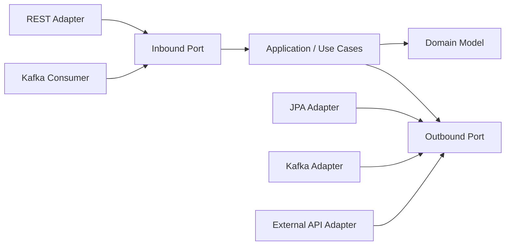

# City Mobility Platform

This repository demonstrates a Spring Boot application built around a rental bounded context following hexagonal architecture and modular monolith principles.

## Architecture

The code is organized around the `rental` bounded context:

- `domain` contains pure business rules and value objects.
- `application` contains use cases, ports, and orchestration logic.
- `adapter` contains inbound and outbound integrations.

The solution intentionally keeps provider logic behind the `RentalProviderPort` abstraction so that new mobility providers can be added without changing the domain or application service.

## Layered comparison

The separate `layeredrental` Spring Modulith module implements the same start-rental scenario with conventional layers: `presentation` contains the controller, `domain` contains the rental model and service, `datasource.persistence` contains the repository, and `datasource.integration` contains the provider clients. The service directly selects and calls the simulated provider clients, using their request and response types. Adding Green Scooter in this example would require another provider branch in the service; in `rental`, the provider adapter implements the application-owned port instead.

Try the layered example with the same request body at `POST /api/layered/rentals`. Both examples support City Bike and Canal Boat, reject Green Scooter, and enforce one active rental per renter. They use separate stores and simulated clients: they are independent demonstrations, not two views of shared rentals. State is lost on restart.

The layered `LayeredRental` is both an anemic data model and a JPA entity: its persistence annotations are in the domain package, while the service contains the rental rule. `LayeredRentalRepository` is a Spring Data JPA repository, backed by in-memory H2 by default. In the hexagonal example, JPA mapping instead lives in the persistence adapter, separate from the domain model.

The direct coupling is a deliberate teaching example, not a requirement of layered architecture. A layered design can also use dependency inversion and isolate its domain.


## Core domain

The domain model supports:

- `RentalId`, `RenterId`, `ProviderId`, `VehicleId`
- `VehicleType` (`BICYCLE`, `SCOOTER`, `BOAT`, `CAR`)
- `RentalStatus` (`ACTIVE`, `COMPLETED`)
- `Rental` aggregate with `start(...)`, `swapVehicle(...)`, and `complete(...)`

## Supported providers

The initial implementation supports:

- City Bike: `city-bike` provider, `BICYCLE` vehicle type
- Canal Boat: `canal-boat` provider, `BOAT` vehicle type

The design is intentionally open for adding Green Scooter without changing the application service or domain.

## Run locally

```bash
./gradlew clean check
./gradlew bootRun
```

The application exposes a rental creation endpoint:

```http
POST /api/rentals
Content-Type: application/json

{
  "renterId": "anna",
  "providerId": "city-bike",
  "vehicleId": "bike-42"
}
```

An active rental can swap to a different vehicle through the provider adapter:

```http
PUT /api/rentals/{rentalId}/vehicle
Content-Type: application/json

{
  "replacementVehicleId": "bike-43"
}
```

The domain permits swaps only while the rental is active, rejects the current vehicle as its own replacement, and validates swap chronology. The use case obtains provider confirmation before saving the new vehicle assignment; provider-specific request and response types remain in their adapters.

The hexagonal rental module uses the in-memory repository by default. To run it with the JPA persistence adapter and the included in-memory H2 database, activate the `jpa` profile:

```bash
./gradlew bootRun --args='--spring.profiles.active=jpa'
```

`JpaRentalRepository` implements the same application-owned `RentalRepository` port as the in-memory adapter. `RentalEntity` and the Spring Data repository stay inside the persistence adapter; the domain model has no JPA annotations or dependencies. The H2 database is temporary and is cleared when the application stops.

## Tests

The project includes:

- domain tests for value objects and aggregate invariants
- application tests for provider registry and use-case orchestration
- architecture tests to enforce dependency boundaries
- JPA repository tests for persistence mapping and rental reconstitution
- controller tests covering the REST adapter

# Arch rules

- Business concepts belong inside; technology choices belong outside.
- Dependencies point toward the domain. 
- Domain must not depend on infrastructure
- Domain imports nothing from infrastructure
- The domain must not know how data is persisted
- The domain must not know about REST
- Infrastructure implements ports defined inside
- Infrastructure must not import domain use cases, only ports in domain
- Don't leak infrastructure types through ports
- Keep Spring Boot at the outside. 
  (Domain does not need @Service
    @Component
    @Repository
    @Configuration
    @Autowired)
- Arch tests	
```java
@ArchTest
    static final ArchRule domain_must_not_depend_on_infrastructure =
        noClasses()
            .that()
            .resideInAPackage("..domain..")
            .should()
            .dependOnClassesThat()
            .resideInAPackage("..infrastructure..");
```



# Ideas for extension

* **Extend vehicle-swap history:** retain every old/new vehicle pair and timestamp for auditing, rather than only the current vehicle and most recent swap time.
* **Calculate the fare:** apply a tariff’s unlock fee, included time, per-minute rate, rounding rules, and price cap. Pass the usage duration or start/end instants explicitly so the calculation is deterministic and easy to test.
* **Choose the best tariff:** calculate the total under several eligible plans and select the lowest valid price. Keep tariff eligibility and pricing rules in a domain policy rather than embedding them in the controller or repository.
* **Extend a rental:** permit extensions only while active, subject to maximum duration and any applicable pricing rules.
* **Cancel or end early:** define when cancellation is allowed and whether it incurs a fee or refund.
Handle overdue rentals: calculate late fees or transition to an overdue state based on the agreed return time and grace period.
