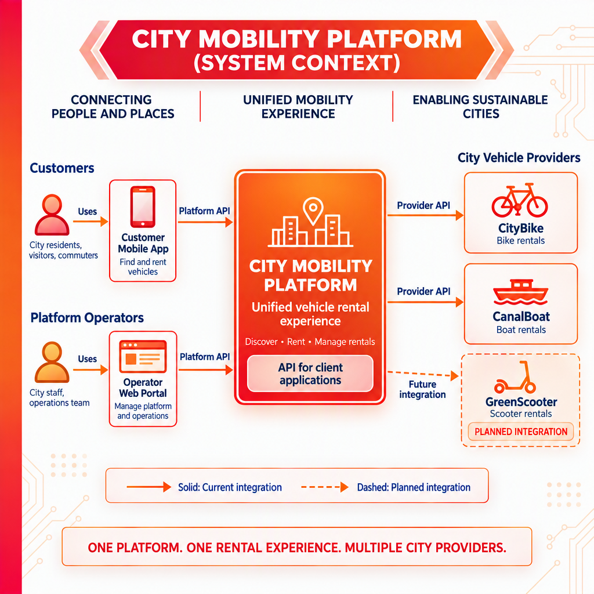
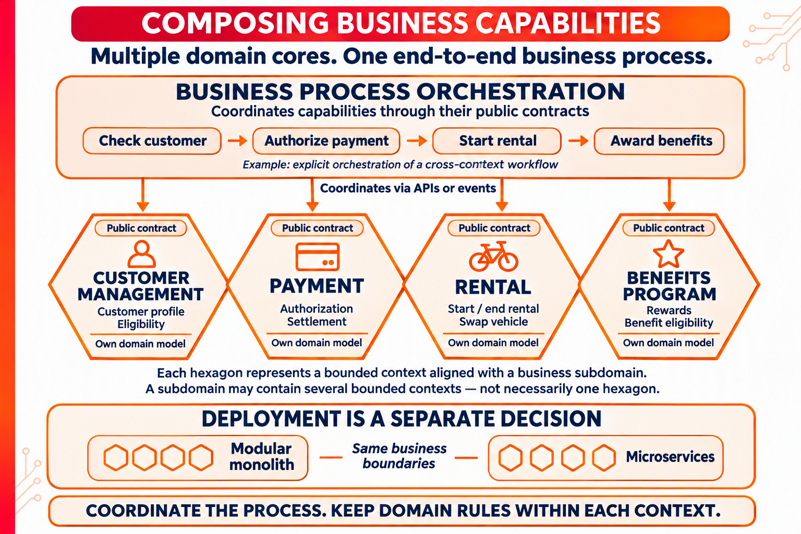
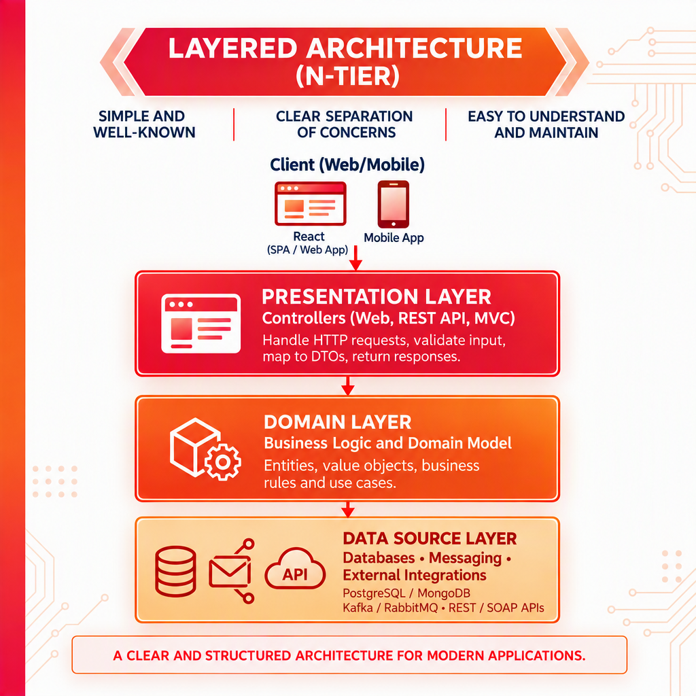
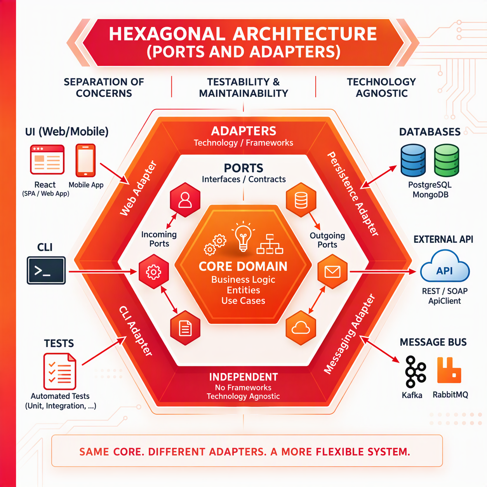
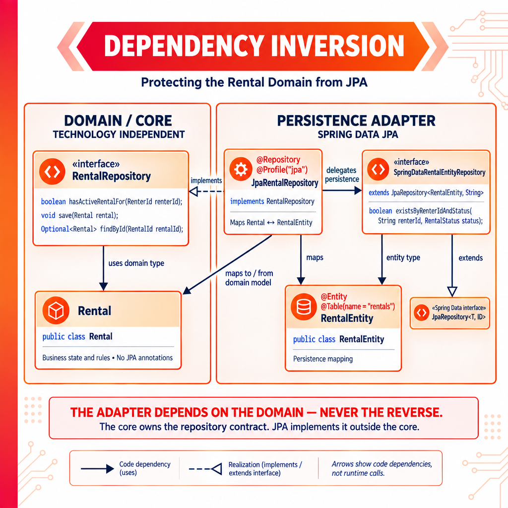
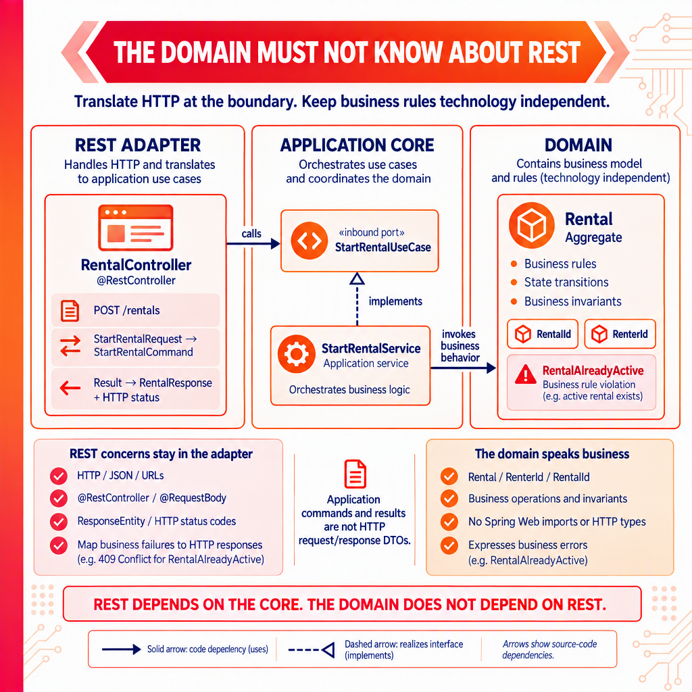
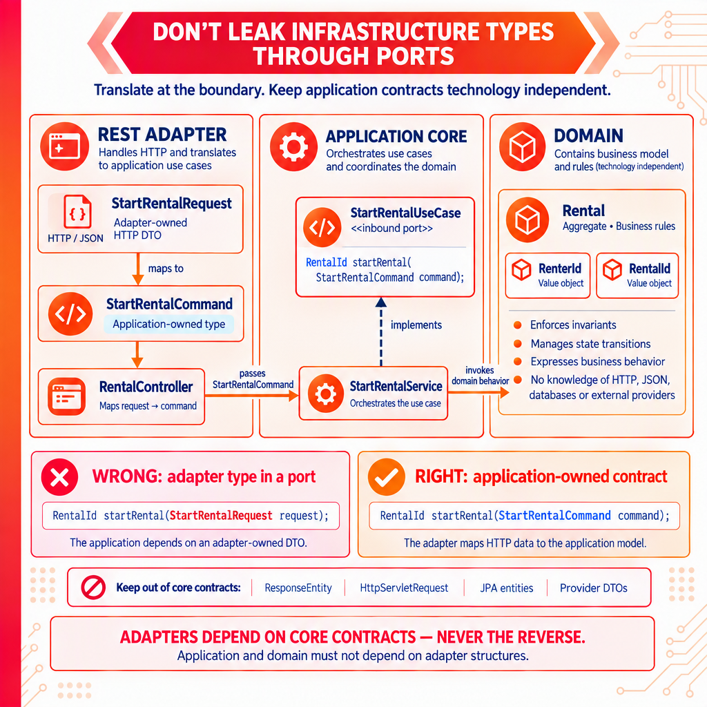
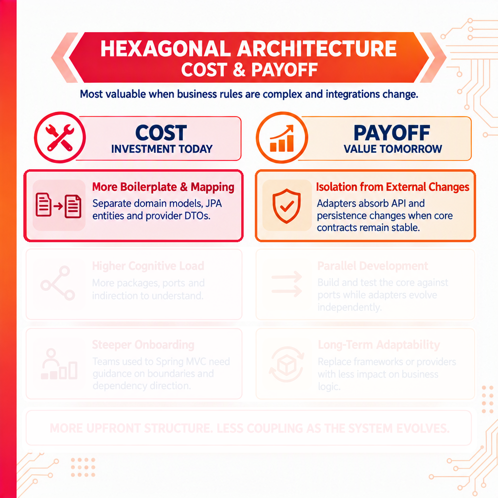
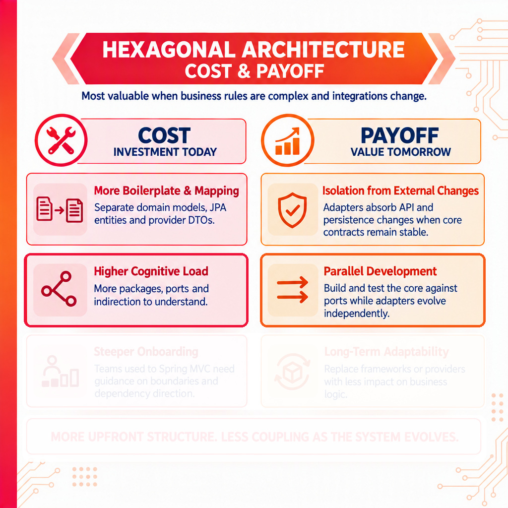
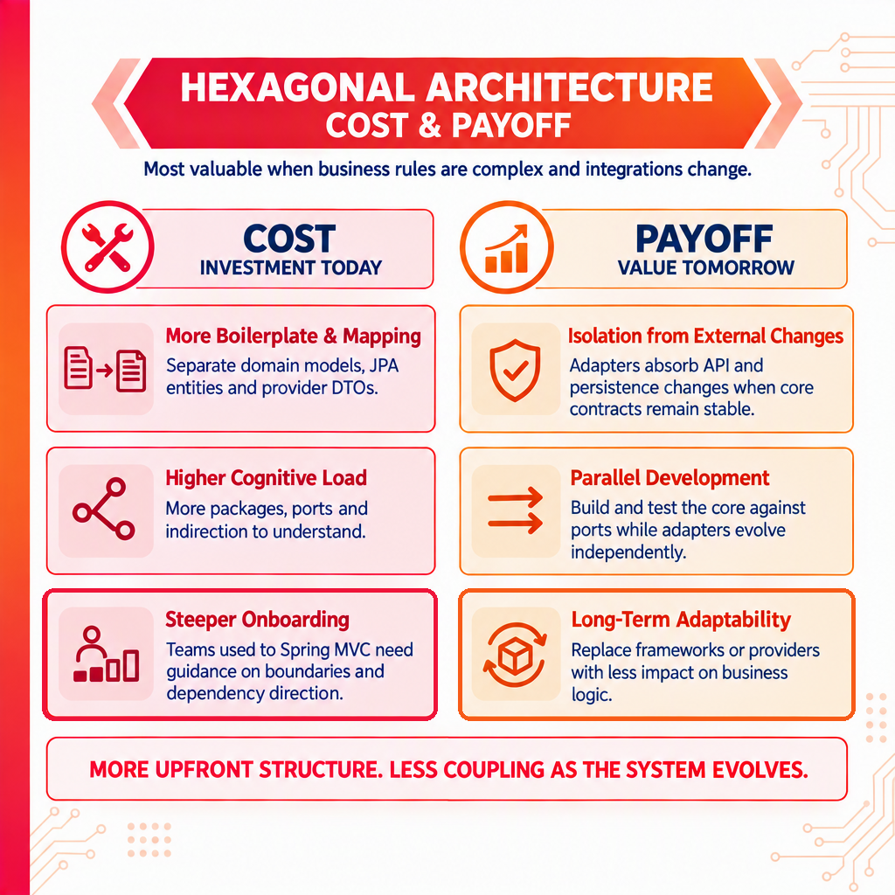

= Architektúra v izolácii
:subtitle: Chráňte svoje doménové jadro
:author: Ivan Macalák
:revealjs_theme: sky
:revealjs_transition: fade
:revealjs_progress: true
:revealjs_slideNumber: true
:source-highlighter: highlight.js

== Kontakt

Ivan Macalák

* mailto:macalak@itexperts.com[macalak@itexperts.com]
* https://github.com/macalak[github.com/macalak]
* https://linkedin.com/in/ivanmacalak[linkedin.com/in/ivanmacalak]

JavaDays 2026

== The Question

How often do we let databases, web frameworks, and external APIs dictate how we model our business?

== The Goal

Put business logic back in the driver's seat.

== The City Mobility Platform

[.notes]
--
The demo implements the rental bounded context. City Bike and Canal Boat are supported; Green Scooter is the live extension exercise.
--

== Architecture

== Trade-offs & Pragmatic Approach

[quote, Eric Evans, Domain-Driven Design: Tackling Complexity in the Heart of Software]
____
If the architecture isolates the domain-related code in a way that allows a cohesive domain design loosely coupled to the rest of the system, then that architecture can probably support domain-driven design.
____

== DDD: Very Distilled

* Model the business domain first, not the technology.
* *Ubiquitous language:* use shared business terms in conversations, models, APIs, and code.
* *Bounded contexts:* define where a model and its language are consistent.
* *Aggregates:* protect invariants within a consistency boundary.
* *Entities:* represent concepts with identity and lifecycle.
* *Value objects:* model immutable concepts defined by their values.

== DDD: Behavior and Boundaries

* *Domain services:* express behavior that does not belong to one entity or value object.
* *Domain events:* express meaningful business facts, such as `RentalStarted`.
* *Application services and use cases:* coordinate work with the domain and its boundaries.

Put the business model at the center and protect its language, rules, and boundaries.

[.notes]
--
Domain events are examples of DDD concepts, not a claim that this demo publishes those events. Application services can also enforce use-case policies that require information from outside an aggregate.
--

== City Mobility: Business Areas

[.notes]
--
Treat the diagram as a domain map. Rental is implemented; neighboring business areas are illustrative.
--

== The Rental Domain Model

* `Rental` is an aggregate with identity and lifecycle behavior.
* `RentalId`, `RenterId`, `ProviderId`, and `VehicleId` are value objects.
* `RentalStatus` and `VehicleType` express state and classification.
* `start`, `swapVehicle`, and `complete` model rental behavior.

== Logical Horizontal Layers

== Layered Package Structure

[source,text]
----
layeredrental
|- presentation
|- domain
|  |- LayeredRental
|  `- LayeredRentalService
`- datasource
   |- persistence
   `- integration
----

[.notes]
--
The layered example deliberately places business rules in the service and JPA annotations on its anemic rental model. This coupling is a design choice, not a requirement of layered architecture.
--

== Layered: Technology in the Model

* Presentation: `@RestController`
* Service: `@Service`
* Rental data model: `@Entity`
* Persistence: Spring Data JPA repository
* Provider clients: `@Component`

== Live Exercise: Layered

*Add Green Scooter*

. Add the client and provider request/response types.
. Inject the client into `LayeredRentalService`.
. Add a provider branch and translate its response.
. Test the new branch and provider failures.

[.notes]
--
For a Swap Vehicle use case, add an operation to the controller and service; validate the rental and replacement, call the provider, and persist the updated state. The layered example currently implements Start Rental only.
--

== A Technology-Free Domain

== Hexagonal Package Structure

[source,text]
----
rental
|- adapter
|  |- in/web
|  `- out/persistence, provider
|- application
|  |- port/in
|  |- port/out
|  `- service
`- domain
----

== Hexagonal: Dependencies Point Inward

* Inbound adapters translate requests into use-case commands.
* Application services orchestrate use cases through ports.
* The domain owns rental lifecycle rules.
* Outbound adapters implement application-owned ports.
* Spring wires components at the edge.

== Live Exercise: Hexagonal

*Add Green Scooter*

. Add the client and provider request/response types.
. Implement `RentalProviderPort` in a Green Scooter adapter.
. Register the adapter as a Spring bean.
. Test translation, failures, and provider registration.

[.notes]
--
The registry discovers port implementations. The controller, application service, and domain can remain unchanged if the existing port and business rules fit. The current port requires both startRental and swapVehicle; the scooter swap protocol must be defined as part of the exercise.
--

== A New Business Use Case

* Define the `SwapVehicle` command and inbound use case.
* Place lifecycle invariants in `Rental`.
* Orchestrate loading, provider confirmation, and saving through ports.
* Update provider and persistence adapters where needed.
* Test the domain, use case, and adapters separately.

[.notes]
--
Unlike adding a provider that fits the existing contract, a new business capability can require changes to the core. Swap Vehicle is already implemented in the hexagonal example.
--

== The City Mobility Platform: Rules

* The domain must not know about REST or persistence.
* Infrastructure implements ports defined inside the application.
* Do not leak infrastructure types through ports.
* Keep Spring Boot at the outside.
* Protect the architecture automatically.

== Dependency Direction

[.notes]
--
Runtime calls can travel outward through a port while source-code dependencies still point inward. The application owns the repository and provider ports in this project.
--

== The Domain Must Not Know About REST

* The domain does not need `@RestController`.
* The inbound adapter translates HTTP into application and domain language.

== The Domain Must Not Know Persistence

* The use case depends on `RentalRepository`.
* A JPA adapter implements the port.
* Spring configuration supplies the implementation.

== Keep Infrastructure Types Out of Ports

== Keep Spring Boot Outside the Core

* Domain rules and use cases can run as plain Java.
* Spring creates and wires the application and adapters.
* Adapter integration tests still verify Spring, JPA, and provider behavior.

== Protect the Architecture Automatically

[source,java]
----
noClasses()
    .that().resideInAnyPackage("com.example.mobility.rental.application..")
    .should().dependOnClassesThat()
    .resideInAnyPackage("com.example.mobility.rental.adapter..");
----

Use ArchUnit and Spring Modulith tests to check the boundaries.

== Dependency Inversion

== Cost & Payoff: Step 1

== Cost & Payoff: Step 2

== Cost & Payoff: Step 3

[.notes]
--
Ports, adapters, and mappings have a cost. A simple CRUD application may not need the same structure as a system with complex rules and changing integrations. Choose based on the problems and trade-offs, not on the pattern's name.
--

== What About AI?

== Give the Agent a Mission

* `SETUP-AGENT.md` describes the demo's mission, technology, and workflow.
* Start with DDD, ports and adapters, and the City Mobility scenario.
* Ask the agent to inspect the repository and preserve existing behavior.

== Give the Agent Boundaries

* `AGENTS.md` records dependency direction and domain purity.
* Provider protocols stay in adapters.
* New providers should not introduce provider switches in the core.
* Run focused tests and the full verification workflow.

== Takeaway 1: Keep the Domain Pure

Business rules should not know about Spring, JPA, REST, or provider APIs.

== Takeaway 2: Dependencies Point Inward

Infrastructure depends on the core's contracts, not the other way around.

== Takeaway 3: Ports Express Business Needs

Define contracts in application terms; translate technology at the edge.

== Takeaway 4: Flexibility and Testability

Test the core without infrastructure. Replace adapters when their contracts and behavior permit it.

== Takeaway 5: Protect Architecture With Code

Use architecture tests to make important dependency rules executable.

== Děkuji · Ďakujem · Thanks